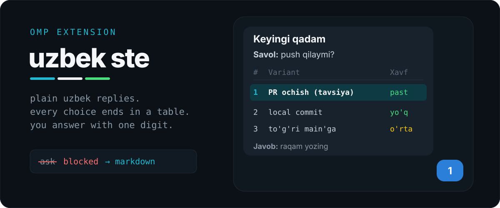

<div align="center">

<p>


<a href="#install"></a>
</p>
</div>

**uzbek ste** is an omp extension for people who drive their coding agent from a phone.
The agent writes plain Uzbek (Latin script) under ASD-STE100 Simplified Technical English rules.
When it needs a decision, it does not open the `ask` dialog.
It ends the reply with a **Keyingi qadam** ("next step") block, and you answer with one digit.

## what you get

Every reply that needs your choice ends like this:

```markdown
---

### Keyingi qadam

**Savol:** push qilaymi?

| # | Variant | Natija | Narx | Xavf |
|---|---|---|---|---|
| **1** | **PR ochish (tavsiya)** | review'dan keyin main'ga | $0 | past |
| 2 | Faqat local commit | GitHub'ga chiqmaydi | $0 | yo'q |
| 3 | To'g'ri main'ga push | darhol live | $0 | o'rta |

**Nega 1-variant:**
- CI main'dan oldin ishlaydi
- Kerak bo'lsa PR'ni yopish oson

**Boshqa variantlar tanlansa:**
- **2:** kod faqat shu kompyuterda qoladi
- **3:** review yo'q, xato bo'lsa main buziladi

**Javob:** raqam yozing, masalan `1`.
```

You type `1`. The agent runs option 1, then offers the next block.

| Column | Meaning |
|---|---|
| `#` | the digit you send |
| `Variant` | what the agent will do; the recommendation is always row 1 |
| `Natija` | the result |
| `Narx` | money cost (paid API calls) |
| `Xavf` | risk |

## why

The `ask` dialog works on a desktop terminal.
In a phone chat bridge, the dialog hides the reply text above it, so you choose blind.
A markdown table stays in the scrollback, works in any client, and needs one keystroke to answer.

## what the rule says

The extension sends one hidden `<uzbek-ste>` message before every agent turn.
It is re-sent each turn because a system prompt alone fades in long chats.
In short, the rule tells the agent to:

- Reply only in Uzbek (Latin), one idea per sentence, max 15 words, lines under 80 characters.
- Use common words, active voice, no idioms.
- Keep code, commands, paths, and logs verbatim, and keep technical terms in English
  (`extension`, `tool`, `hook`, `commit`, `branch`, …) instead of inventing Uzbek words.
- Split replies into bold-titled sections; use tables for 2+ similar items, bullets for 3+ ideas.
- End every open choice with the Keyingi qadam block: 2–5 options, recommendation first.
- Act at once on steps that need no permission; ask only for paid calls, prod, push/deploy,
  database writes, and deletes.
- Skip the block while waiting for a background agent or job.

The full text is the `RULE` constant in [`uzbek-ste.ts`](./uzbek-ste.ts).

## install

Use omp's GitHub plugin installer:

```sh
omp plugin install github:ubranch/omp-uzbek-ste
```

Or copy the file into omp's extension directory:

```sh
mkdir -p ~/.omp/agent/extensions
cp ./uzbek-ste.ts ~/.omp/agent/extensions/uzbek-ste.ts
```

PowerShell:

```powershell
New-Item -ItemType Directory -Force "$HOME/.omp/agent/extensions" | Out-Null
Copy-Item ./uzbek-ste.ts "$HOME/.omp/agent/extensions/uzbek-ste.ts"
```

Restart omp. No build step or dependency install is needed.

## how it works

| Hook | Action |
|---|---|
| `before_agent_start` | adds the rule as a hidden message (`display: false`) |
| `tool_call` | blocks `ask` and tells the agent to write the markdown block instead |

Other tools pass through unchanged.
The message is hidden from the chat display, not from the model.

## token cost

The rule measures **751 tokens** with `tiktoken` `o200k_base`.
This is a tokenizer proxy, not a provider billing measurement.
It is added on every user turn, so earlier copies stay in context until compaction.

## limits

- This is prompt guidance. The model can still break a rule; only the `ask` block is enforced.
- The rule is Uzbek-only. To change the language or the table columns, edit `RULE`.

## development

Requires Bun.

```sh
bun install
bun run typecheck
bun test
```

Tests load the real extension, capture its omp hooks, and check the injected message
and the `ask` block. CI runs the same checks on Ubuntu and Windows.

## license

MIT, copyright 2026 ubranch.
